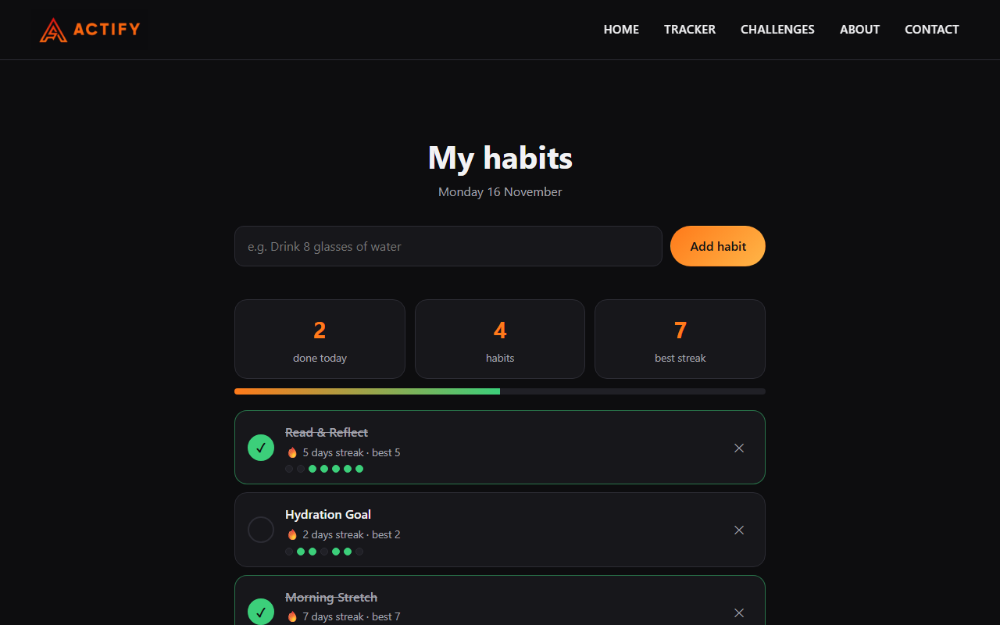

# Actify — Daily Habit Tracker

[](https://codelady-ship.github.io/basic-task-with-Html-Css-Js/)

> AZ: Gündəlik vərdişləri izləmək üçün kiçik veb tətbiq — vərdiş əlavə et, hər gün qeyd et, ardıcıllığını (streak) izlə. Bütün məlumat brauzerdə saxlanılır.

Actify is a small habit tracker built with plain HTML, CSS and JavaScript. Add the habits you want to keep, tick them off every day and watch your streaks grow. There is no account and no server: everything is stored in your browser's `localStorage`.



## Features

- **Habits:** add, check off for today, and delete habits (duplicates are blocked).
- **Streaks:** current streak and best streak for every habit, plus a 7-day history row.
- **Daily stats:** habits done today, total habits, best streak and a progress bar.
- **Challenges:** eight ready-made challenges that you can add to your tracker with one click.
- **Persistence:** data is saved in `localStorage` and survives page reloads.
- **Contact form:** opens a pre-filled email in your mail app (`mailto:`); the site has no backend.
- **Responsive** layout with an accessible mobile menu (390 px to 1920 px).
- **SEO:** meta description, canonical URL, Open Graph/Twitter tags, favicon, `robots.txt` and `sitemap.xml`.

## Tech stack

HTML5 · CSS3 (custom properties, grid, flexbox, media queries) · vanilla JavaScript (ES6+) · `localStorage`

## Run locally

No build step is needed.

```bash
git clone https://github.com/codelady-ship/basic-task-with-Html-Css-Js.git
cd basic-task-with-Html-Css-Js
npx serve .        # or open index.html directly in a browser
```

## Deployment

The site is served by **GitHub Pages** from the root of the `main` branch. Every push to `main` is published automatically at
<https://codelady-ship.github.io/basic-task-with-Html-Css-Js/>.

## Project structure

```
index.html       page markup and SEO tags
style.css        main styles and design tokens
responsive.css   tablet and phone breakpoints
app.js           habit tracker logic, mobile menu, contact form
assets/logo.png  Actify logo
favicon.svg, robots.txt, sitemap.xml
```

## What I learned

- Keeping app state in one array and re-rendering the list from it, instead of editing the DOM in many places.
- Saving and loading JSON with `localStorage`, and handling broken or missing data safely.
- Working with dates in local time (`YYYY-MM-DD` keys) to calculate current and best streaks.
- Building an accessible mobile menu with a real `<button>`, `aria-expanded` and proper `<ul><li>` markup.
- Debugging a deployed site: a wrong `<script src>` and an unlinked stylesheet silently broke the first version.
- Being honest in UI copy: a form without a backend should say so instead of pretending to send.
